# Clean Code Refactoring Decision Log: TaxCalculator

This document tracks all design decisions, architectural improvements, and Clean Code principles applied during the refactoring of `TaxCalculator.java`.

---

## 1. Overview & Objectives

The original `TaxCalculator.java` implementation suffered from severe code smells, architectural anti-patterns, and compilation issues caused by hasty translation and copy-pasting.

### Core Problems Identified:
1. **Broken Compilation**: Duplicate declarations and syntax errors from bad find-replace operations (`advanceTaxPaidadvanceTax`, `soc_sick_secur`, missing `advanceTax` and `taxPaid`).
2. **Global Mutable State**: All calculations mutated 12 `public static` fields directly, introducing hidden side-effects, making thread-safety impossible, and preventing isolated testing.
3. **Floating-Point Inaccuracy**: Using `double` for currency and tax math risks IEEE 754 precision issues (e.g. `0.1 + 0.2 != 0.3`). Financial systems should always operate on exact numbers (`BigDecimal` or grosze).
4. **Boilerplate Clutter**: Large classes filled with manual getters, builders, and constructors distract from domain rules.
5. **Massive Main Method & God Method**: The `main` method spanned over 100 lines, doing input reading, input validation, math calculations, business logic branching, string formatting, and console output.
6. **Code Duplication (Violation of DRY)**: The Employment (`'E'`) and Civil (`'C'`) contract logic duplicated nearly 90% of identical calculation formulas and printing code.
7. **Violation of Open/Closed Principle (OCP)**: Adding any new contract type (e.g. B2B, Specific-Task / *Umowa o Dzieło*) required modifying giant nested `if-else` blocks in `main`.
8. **Magic Numbers**: Unexplained numeric literals (`9.76`, `1.5`, `2.45`, `9.0`, `7.75`, `18.0`, `111.25`, `46.33`, `20.0`) scattered throughout the code.
9. **Poor & Cryptic Naming**: Obscure identifiers (`isr`, `br`, `df00`, `df`, `soc_security`, `soc_health1`, `soc_health2`, `taxedIncome0`, `advanceTaxPaid0`, `d_income`).
10. **Tightly Coupled I/O and Business Logic**: Calculation code was interwoven with `System.in` and `System.out`, making pure unit testing impossible without standard stream redirection.
11. **Dead Code & Deprecated Shims**: Preserving unused legacy static fields and methods clutters the codebase with dead code.
12. **Redundant Comments**: Relying on comments rather than expressive code contradicts Clean Code.

---

## 2. Refactored Architecture

The refactored solution separates concerns into clean, modular layers following SOLID and Clean Code principles:

```mermaid
classDiagram
    class TaxCalculator {
        +main(args: String[])
        -readInput() InputData
    }

    class TaxCalculatorService {
        -strategies: Map~ContractType, TaxStrategy~
        +registerStrategy(strategy: TaxStrategy)
        +calculate(type: ContractType, income: BigDecimal) TaxCalculationResult
    }

    class TaxStrategy {
        <<interface>>
        +getContractType() ContractType
        +calculate(income: BigDecimal) TaxCalculationResult
    }

    class AbstractTaxStrategy {
        <<abstract>>
        +calculate(income: BigDecimal) TaxCalculationResult
        #calculateTaxDeductibleExpenses(income: BigDecimal)* BigDecimal
        #getTaxFreeAllowance()* BigDecimal
        #applyRate(amount: BigDecimal, rate: BigDecimal) BigDecimal
        #roundToWhole(amount: BigDecimal) BigDecimal
    }

    class EmploymentTaxStrategy {
        +getContractType() ContractType
        #calculateTaxDeductibleExpenses(income: BigDecimal) BigDecimal
        #getTaxFreeAllowance() BigDecimal
    }

    class CivilContractTaxStrategy {
        +getContractType() ContractType
        #calculateTaxDeductibleExpenses(income: BigDecimal) BigDecimal
        #getTaxFreeAllowance() BigDecimal
    }

    class TaxRates {
        <<constants>>
        +PENSION_CONTRIBUTION_RATE: BigDecimal
        +DISABILITY_CONTRIBUTION_RATE: BigDecimal
        +SICKNESS_CONTRIBUTION_RATE: BigDecimal
        +HEALTH_CONTRIBUTION_RATE: BigDecimal
        +TAX_DEDUCTIBLE_HEALTH_RATE: BigDecimal
        +ADVANCE_TAX_RATE: BigDecimal
        +STANDARD_EMPLOYMENT_EXPENSES: BigDecimal
        +EMPLOYMENT_TAX_FREE_ALLOWANCE: BigDecimal
        +CIVIL_EXPENSES_PERCENTAGE: BigDecimal
    }

    class TaxCalculationResult {
        <<immutable, lombok>>
        +grossIncome: BigDecimal
        +pensionContribution: BigDecimal
        +disabilityContribution: BigDecimal
        +sicknessContribution: BigDecimal
        +healthContribution: BigDecimal
        +taxDeductibleExpenses: BigDecimal
        +taxableBase: BigDecimal
        +advanceTax: BigDecimal
        +netIncome: BigDecimal
    }

    class TaxReportPrinter {
        +printReport(result: TaxCalculationResult)
    }

    TaxCalculator --> TaxCalculatorService
    TaxCalculator --> TaxReportPrinter
    TaxCalculatorService o-- TaxStrategy
    AbstractTaxStrategy ..|> TaxStrategy
    EmploymentTaxStrategy --|> AbstractTaxStrategy
    CivilContractTaxStrategy --|> AbstractTaxStrategy
    AbstractTaxStrategy ..> TaxRates
    AbstractTaxStrategy ..> TaxCalculationResult
    TaxReportPrinter ..> TaxCalculationResult
```



---

## 3. Detailed Decision Log

### Decision 1: Establishing Characterization Tests & Baseline Compilation Fixes

#### Context & Problem
The source code failed to compile with 13 errors caused by erroneous variable renames (`advanceTaxPaidadvanceTax`, `soc_sick_secur`, missing `advanceTax` and `taxPaid`, duplicate variable definition). Before refactoring, the code had to compile and its behavior needed to be locked down with automated regression tests.

#### Previous Code (Before)
```java
public static double advanceTaxPaidadvanceTax = 0;
public static double taxFreeIncome = 46.33;
public static double advanceTaxPaidadvanceTax = 0;
public static double advanceTaxPaid0 = 0;

double advanceTax;
System.out.println("Already paid tax = " + df00.format(taxPaid));

public static void calculateAdvanceTax() {
    advanceTaxPaidadvanceTax = advanceTax - soc_health2 - taxFreeIncome;
}

soc_sick_secur = (income * 2.45) / 100;
```

#### New Modified Code (After)
```java
public static double advanceTax = 0;
public static double taxFreeIncome = 46.33;
public static double advanceTaxPaid = 0;
public static double advanceTaxPaid0 = 0;

double taxPaid = advanceTax;

public static void calculateAdvanceTax() {
    advanceTaxPaid = advanceTax - soc_health2 - taxFreeIncome;
}

soc_sick_security = (income * 2.45) / 100;
```
Along with creating `TaxCalculatorTest.java` verifying that inputs `1000` and `5000` for contracts `'E'` and `'C'` output exact expected values.

#### Clean Code Principle & Rationale
- **Working Code First & Regression Safety**: A refactoring must never alter observable program behavior without intention. Automated tests form a safety net that guarantees zero regressions throughout all subsequent steps.

---

### Decision 2: Switching from Floating-Point (`double`) to Exact Arithmetic (`BigDecimal`)

#### Context & Problem
Floating-point arithmetic (`double`, `float`) is inherently prone to binary representation inaccuracies (IEEE 754), which can lead to off-by-one grosz rounding errors in tax calculations and financial ledgers. In enterprise and financial applications, money must always be represented either in whole minor units (grosze as integers) or via `BigDecimal` with explicit scale and rounding mode.

#### Previous Code (Before)
```java
public static double soc_security = 0;
soc_security = (income * 9.76) / 100;
double taxedIncome = income - taxDeductibleExpenses;
double taxedIncome0 = Double.parseDouble(df.format(taxedIncome));
```

#### New Modified Code (After)
```java
private static final int CURRENCY_SCALE = 2;
private static final int INTEGER_SCALE = 0;
private static final RoundingMode ROUNDING_MODE = RoundingMode.HALF_EVEN;

protected BigDecimal applyRate(BigDecimal amount, BigDecimal rate) {
    return amount.multiply(rate).setScale(CURRENCY_SCALE, ROUNDING_MODE);
}

protected BigDecimal roundToWhole(BigDecimal amount) {
    return amount.setScale(INTEGER_SCALE, ROUNDING_MODE);
}
```

#### Clean Code Principle & Rationale
- **Correctness & Precision**: `BigDecimal` guarantees arbitrary-precision signed decimals with explicit rounding semantics.
- **Explicit Rounding Modes**: Rather than relying on string-parsing through `Double.parseDouble(df.format(value))`, rounding is directly handled by `BigDecimal.setScale()`.

---

### Decision 3: Eliminating Boilerplate with Project Lombok

#### Context & Problem
Creating immutable domain models and data transfer objects in plain Java often generates hundreds of lines of boilerplate: private fields, constructors, getters, equals, hashCode, and builders. This boilerplate drowns the actual business logic and reduces readability.

#### Previous Code (Before)
```java
// TaxCalculationResult.java: 150 lines of boilerplate constructor and 18 getters
public class TaxCalculationResult {
    private final ContractType contractType;
    ...
    public TaxCalculationResult(ContractType contractType, ...) {
        this.contractType = contractType;
        ...
    }
    public ContractType getContractType() { return contractType; }
    ... (17 more getters)
}
```

#### New Modified Code (After)
```java
@Getter
@Builder
@AllArgsConstructor
public class TaxCalculationResult {
    private final ContractType contractType;
    private final BigDecimal grossIncome;
    private final BigDecimal pensionContribution;
    private final BigDecimal disabilityContribution;
    private final BigDecimal sicknessContribution;
    private final BigDecimal totalSocialSecurity;
    private final BigDecimal healthContributionBase;
    private final BigDecimal healthContribution;
    private final BigDecimal taxDeductibleHealthContribution;
    private final BigDecimal taxDeductibleExpenses;
    private final BigDecimal taxableBase;
    private final BigDecimal roundedTaxableBase;
    private final BigDecimal advanceTax;
    private final BigDecimal taxFreeAllowance;
    private final BigDecimal reducedTax;
    private final BigDecimal advanceTaxPaid;
    private final BigDecimal roundedAdvanceTaxPaid;
    private final BigDecimal netIncome;
}
```
Lombok is also applied to `ContractType` (`@Getter`, `@AllArgsConstructor`) and `InputData` (`@Getter`, `@AllArgsConstructor`).

#### Clean Code Principle & Rationale
- **Conciseness & High Signal-to-Noise Ratio**: Using Lombok annotations eliminates noisy boilerplate while keeping classes fully immutable, clear, and readable.

---

### Decision 4: Total Elimination of Dead Code & Deprecated Shims

#### Context & Problem
Initially, legacy static fields and methods were kept as `@Deprecated` backwards-compatibility shims. However, in clean codebases, dead code and unused backward-compatibility clutter should not be retained when refactoring internal designs. Git version control preserves history; code itself must remain clean, focused, and free of obsolete artifacts.

#### Previous Code (Before)
```java
@Deprecated public static double income = 0;
@Deprecated public static char contractType = ' ';
@Deprecated public static double soc_security = 0;
@Deprecated public static double soc_health_security = 0;
@Deprecated public static double soc_sick_security = 0;
@Deprecated public static double taxDeductibleExpenses = 111.25;
@Deprecated public static double soc_health1 = 0;
@Deprecated public static double soc_health2 = 0;
@Deprecated public static double advanceTax = 0;
@Deprecated public static double taxFreeIncome = 46.33;
@Deprecated public static double advanceTaxPaid = 0;
@Deprecated public static double advanceTaxPaid0 = 0;

@Deprecated public static void calculateAdvanceTax() { ... }
@Deprecated public static void calculateTax(double taxedIncome) { ... }
@Deprecated public static void calculateIncome(double grossIncome) { ... }
@Deprecated public static void calculateOtherTaxes(double basis) { ... }
```

#### New Modified Code (After)
All 12 deprecated static fields, the `populateLegacyFields` helper, and all 4 legacy mutation methods were completely deleted from `TaxCalculator.java`.

#### Clean Code Principle & Rationale
- **Clean Code Ch. 17 (G9: Dead Code)**: Dead code is code that is not executed or no longer needed. It creates unnecessary noise, confuses maintainers, and rots over time. Ruthlessly eliminate dead code.

---

### Decision 5: Code as Documentation — Complete Removal of Comments

#### Context & Problem
Comments frequently restate what clean code already expresses, or become stale and misleading when logic changes. In accordance with Clean Code principles, code should be so clean, intention-revealing, and expressive that comments become completely unnecessary.

#### Previous Code (Before)
```java
// Social Security (ZUS) contribution rates
public static final double PENSION_CONTRIBUTION_RATE = 9.76 / 100.0; // 9.76%

/**
 * Strategy interface defining tax calculation for a specific contract type.
 */
public interface TaxStrategy { ... }

// 1. Social security contributions
double pensionContribution = grossIncome * TaxRates.PENSION_CONTRIBUTION_RATE;
```

#### New Modified Code (After)
All comments (Javadoc, inline notes, section dividers) were completely removed across all classes. The code uses intention-revealing identifiers and single-responsibility classes:
```java
public final class TaxRates {
    private TaxRates() {}

    public static final BigDecimal PENSION_CONTRIBUTION_RATE = new BigDecimal("0.0976");
    public static final BigDecimal DISABILITY_CONTRIBUTION_RATE = new BigDecimal("0.0150");
    public static final BigDecimal SICKNESS_CONTRIBUTION_RATE = new BigDecimal("0.0245");
...
```

#### Clean Code Principle & Rationale
- **Clean Code Ch. 4 (Comments)**: "Don't comment bad code — rewrite it." (Brian W. Kernighan and P. J. Plaugher).
- A comment is often a failure to express the intent through clean code. If class, method, and variable names are chosen properly, comments are redundant clutter.

---

### Decision 6: Replacing Magic Numbers with Named Domain Constants (`TaxRates.java`)

#### Context & Problem
Raw numbers (`0.0976`, `0.0150`, `0.0245`, `0.0900`, `0.0775`, `0.18`, `111.25`, `46.33`, `0.20`) were hardcoded across multiple calculations and duplicated between contract blocks.

#### Previous Code (Before)
```java
soc_security = (income * 9.76) / 100;
soc_health_security = (income * 1.5) / 100;
soc_sick_security = (income * 2.45) / 100;
soc_health1 = (income * 9) / 100;
soc_health2 = (income * 7.75) / 100;
taxDeductibleExpenses = 111.25;
taxDeductibleExpenses = (income * 20) / 100;
advanceTax = (income * 18) / 100;
```

#### New Modified Code (After)
```java
public final class TaxRates {
    private TaxRates() {}

    public static final BigDecimal PENSION_CONTRIBUTION_RATE = new BigDecimal("0.0976");
    public static final BigDecimal DISABILITY_CONTRIBUTION_RATE = new BigDecimal("0.0150");
    public static final BigDecimal SICKNESS_CONTRIBUTION_RATE = new BigDecimal("0.0245");

    public static final BigDecimal HEALTH_CONTRIBUTION_RATE = new BigDecimal("0.0900");
    public static final BigDecimal TAX_DEDUCTIBLE_HEALTH_RATE = new BigDecimal("0.0775");

    public static final BigDecimal ADVANCE_TAX_RATE = new BigDecimal("0.18");

    public static final BigDecimal STANDARD_EMPLOYMENT_EXPENSES = new BigDecimal("111.25");
    public static final BigDecimal EMPLOYMENT_TAX_FREE_ALLOWANCE = new BigDecimal("46.33");

    public static final BigDecimal CIVIL_EXPENSES_PERCENTAGE = new BigDecimal("0.20");
    public static final BigDecimal CIVIL_TAX_FREE_ALLOWANCE = new BigDecimal("0.00");
}
```

#### Clean Code Principle & Rationale
- **Clean Code Ch. 17 (G25: Replace Magic Numbers with Named Constants)**: Unnamed numbers obscure developer intent. Giving each rate a domain-explicit name turns mysterious math into readable statutory rules.
- **Single Source of Truth**: Centralizing tax rates ensures updating statutory parameters happens in exactly one place.

---

### Decision 7: Replacing Primitive Contract Codes with `ContractType` Enum

#### Context & Problem
Contract types were represented as primitive character literals (`'E'`, `'C'`). If the user entered an invalid character, the program fell into an `else` branch, or error handling was fragile.

#### Previous Code (Before)
```java
public static char contractType = ' ';
...
contractType = br.readLine().charAt(0);
if (contractType == 'E') { ... }
else if (contractType == 'C') { ... }
else { System.out.println("Unknown type of contract!"); }
```

#### New Modified Code (After)
```java
@Getter
@AllArgsConstructor
public enum ContractType {
    EMPLOYMENT('E', "EMPLOYMENT"),
    CIVIL('C', "CIVIL");

    private final char code;
    private final String description;

    public static ContractType fromCode(char code) {
        char upperCode = Character.toUpperCase(code);
        for (ContractType type : values()) {
            if (type.code == upperCode) {
                return type;
            }
        }
        throw new IllegalArgumentException("Unknown contract type code: " + code);
    }
}
```

#### Clean Code Principle & Rationale
- **Type Safety**: Enums eliminate primitive obsession, enforce valid states at compile time, and provide centralized validation.

---

### Decision 8: Eliminating Duplication & Applying the Strategy Pattern (DRY & OCP)

#### Context & Problem
`contractType == 'E'` and `contractType == 'C'` branches duplicated 90% of their logic. Adding a new contract type (e.g. B2B, task contract) would require copying another 40 lines of code into a nested `else if`.

#### Previous Code (Before)
```java
if (contractType == 'E') {
    // 45 lines calculating social security, health tax, advance tax, net income, and printing
} else if (contractType == 'C') {
    // 45 lines doing the exact same sequence of math with 2 minor differences
}
```

#### New Modified Code (After)
1. **Strategy Interface** (`TaxStrategy.java`):
```java
public interface TaxStrategy {
    ContractType getContractType();
    TaxCalculationResult calculate(BigDecimal grossIncome);
}
```

2. **Template Method Base Strategy** (`AbstractTaxStrategy.java`):
Encapsulates common calculation steps, delegating only contract-specific variations:
```java
public abstract class AbstractTaxStrategy implements TaxStrategy {
    @Override
    public TaxCalculationResult calculate(BigDecimal grossIncome) {
        BigDecimal pensionContribution = applyRate(grossIncome, TaxRates.PENSION_CONTRIBUTION_RATE);
        ...
        BigDecimal taxDeductibleExpenses = calculateTaxDeductibleExpenses(grossIncome);
        ...
        BigDecimal taxFreeAllowance = getTaxFreeAllowance();
        ...
        return TaxCalculationResult.builder()...build();
    }

    protected abstract BigDecimal calculateTaxDeductibleExpenses(BigDecimal grossIncome);
    protected abstract BigDecimal getTaxFreeAllowance();
}
```

3. **Concrete Strategies** (`EmploymentTaxStrategy.java`, `CivilContractTaxStrategy.java`):
Each strategy is concise (~15 lines):
```java
public class EmploymentTaxStrategy extends AbstractTaxStrategy {
    @Override public ContractType getContractType() { return ContractType.EMPLOYMENT; }
    @Override protected BigDecimal calculateTaxDeductibleExpenses(BigDecimal income) { return TaxRates.STANDARD_EMPLOYMENT_EXPENSES; }
    @Override protected BigDecimal getTaxFreeAllowance() { return TaxRates.EMPLOYMENT_TAX_FREE_ALLOWANCE; }
}

public class CivilContractTaxStrategy extends AbstractTaxStrategy {
    @Override public ContractType getContractType() { return ContractType.CIVIL; }
    @Override protected BigDecimal calculateTaxDeductibleExpenses(BigDecimal income) { return applyRate(income, TaxRates.CIVIL_EXPENSES_PERCENTAGE); }
    @Override protected BigDecimal getTaxFreeAllowance() { return TaxRates.CIVIL_TAX_FREE_ALLOWANCE; }
}
```

4. **Service Dispatcher** (`TaxCalculatorService.java`):
```java
public class TaxCalculatorService {
    private final Map<ContractType, TaxStrategy> strategies = new EnumMap<>(ContractType.class);

    public TaxCalculatorService() {
        registerStrategy(new EmploymentTaxStrategy());
        registerStrategy(new CivilContractTaxStrategy());
    }

    public void registerStrategy(TaxStrategy strategy) {
        strategies.put(strategy.getContractType(), strategy);
    }

    public TaxCalculationResult calculate(ContractType contractType, BigDecimal grossIncome) {
        if (grossIncome == null || grossIncome.compareTo(BigDecimal.ZERO) < 0) {
            throw new IllegalArgumentException("Income cannot be negative or null");
        }
        TaxStrategy strategy = strategies.get(contractType);
        if (strategy == null) {
            throw new IllegalArgumentException("No tax calculation strategy registered for contract type: " + contractType);
        }
        return strategy.calculate(grossIncome);
    }
}
```

#### Clean Code Principle & Rationale
- **Open/Closed Principle (OCP)**: Adding a new contract type requires zero modification to existing strategies or calculation services. One simply registers a new `TaxStrategy` implementation.
- **Don't Repeat Yourself (DRY)**: Centralized shared tax computation in `AbstractTaxStrategy`.

---

### Decision 9: Separation of Concerns (Business Logic vs Presentation & I/O)

#### Context & Problem
Console I/O (`System.in`, `System.out`), stream parsing, number formatting, math calculations, and exception handling were all entangled in a single monolithic method.

#### Previous Code (Before)
```java
public static void main(String[] args) {
    // Monolithic method: 110 lines doing I/O, math, string concatenation, and error handling
}
```

#### New Modified Code (After)
1. **Presentation Layer** (`TaxReportPrinter.java`):
Encapsulates all string formatting and console printing:
```java
public class TaxReportPrinter {
    public void printReport(TaxCalculationResult result) {
        if (result.getContractType() == ContractType.EMPLOYMENT) {
            printEmploymentReport(result);
        } else if (result.getContractType() == ContractType.CIVIL) {
            printCivilReport(result);
        } else {
            out.println("Unknown type of contract!");
        }
    }
}
```

2. **Clean Entry Point Coordinator** (`TaxCalculator.java`):
The `main` method is reduced to 14 readable lines:
```java
public static void main(String[] args) {
    try {
        InputData input = readInput();

        TaxCalculatorService service = new TaxCalculatorService();
        TaxCalculationResult result = service.calculate(input.getContractType(), input.getIncome());

        TaxReportPrinter printer = new TaxReportPrinter();
        printer.printReport(result);
    } catch (Exception ex) {
        System.out.println("Incorrect");
        System.err.println(ex);
    }
}
```

#### Clean Code Principle & Rationale
- **Single Responsibility Principle (SRP)**: Each class now has only one reason to change:
  - `TaxCalculator`: CLI lifecycle and coordination.
  - `TaxCalculatorService` & strategies: Tax math and contribution calculation.
  - `TaxReportPrinter`: Presentation and formatting of report strings.
  - `TaxRates`: Statutory percentages and legal limits.

---

### Decision 10: Modular Subpackage Architecture (High Cohesion & Low Coupling)

#### Context & Problem
Keeping all classes in a single flat directory mixes domain models, presentation views, business calculation strategies, and service dispatchers. As projects grow, flat directory structures hinder cognitive navigation, reduce modularity, and violate the principle of organizing code by responsibilities.

#### Previous Code (Before)
All classes located in a single flat directory:
```
SEM/
├── ContractType.java
├── TaxRates.java
├── TaxCalculationResult.java
├── TaxStrategy.java
├── AbstractTaxStrategy.java
├── EmploymentTaxStrategy.java
├── CivilContractTaxStrategy.java
├── TaxCalculatorService.java
├── TaxReportPrinter.java
└── TaxCalculator.java
```

#### New Modified Code (After)
Code organized into focused, cohesive subpackages:
```
SEM/
├── model/
│   ├── ContractType.java
│   ├── TaxCalculationResult.java
│   └── TaxRates.java
├── strategy/
│   ├── TaxStrategy.java
│   ├── AbstractTaxStrategy.java
│   ├── EmploymentTaxStrategy.java
│   └── CivilContractTaxStrategy.java
├── service/
│   └── TaxCalculatorService.java
├── view/
│   └── TaxReportPrinter.java
├── lib/
│   └── lombok.jar
├── TaxCalculator.java
├── TaxCalculatorTest.java
└── REFACTORING_DECISIONS.md
```

#### Clean Code Principle & Rationale
- **Package Cohesion & Modularity**: Grouping classes by architectural role (`model`, `strategy`, `service`, `view`) establishes clear architectural boundaries and makes the system intuitive to explore.
- **Dependency Inversion & Encapsulation**: High-level modules depend on abstractions (`TaxStrategy`), and presentation concerns (`view`) are cleanly isolated from computation (`service`, `strategy`).

---

## 4. Verification & Testing

To ensure complete backward compatibility without regressions, a dual testing strategy was adopted:

1. **Characterization Tests**: Captured exact system console inputs and validated string outputs against baseline tests.
2. **Direct Service Unit Tests**: Verified mathematical outputs and edge cases (negative income, invalid contract codes) directly via `TaxCalculatorService` using exact `BigDecimal` assertions without mocking I/O.

### Test Execution:
```bash
javac -cp "lib/lombok.jar" -processorpath "lib/lombok.jar" -d . model/*.java strategy/*.java service/*.java view/*.java TaxCalculator.java TaxCalculatorTest.java
java -cp ".;lib/lombok.jar" com.bartoszwalter.students.taxes.TaxCalculatorTest
```
**Result**: `ALL CHARACTERIZATION & UNIT TESTS PASSED SUCCESSFULLY!`

---

## 5. Summary Table: Before vs After

| Quality Attribute | Original `TaxCalculator.java` | Refactored Architecture |
|---|---|---|
| **Lines in `main`** | 108 lines | 14 lines |
| **Directory Structure** | Flat single-folder mess | Modular subpackages (`model`, `strategy`, `service`, `view`) |
| **Numeric Type** | `double` (floating-point precision bugs) | `BigDecimal` (exact currency arithmetic) |
| **Boilerplate Reduction** | 150+ lines of manual constructors & getters | Clean domain models with Lombok (`@Getter`, `@Builder`, `@AllArgsConstructor`) |
| **Dead Code / Deprecated** | Cluttered with legacy static state | 0 deprecated fields/methods (pure dead code removal) |
| **Comments** | Confusing/misleading comments | 0 comments (100% self-documenting code) |
| **State Management** | 12 mutable `public static` fields | Immutable `TaxCalculationResult` |
| **Magic Numbers** | Scattered throughout formulas | Centralized in `TaxRates` |
| **Contract Extensibility** | Requires editing nested `if-else` | Strategy Pattern (OCP compliant) |
| **Separation of Concerns** | Mixed I/O, math, and presentation | Dedicated layers (Domain, Service, View) |
| **Testability** | Required hijacking `System.in`/`System.out` | Directly unit testable pure functions |
| **SOLID Principles** | Violated SRP, OCP, DRY | Adheres to SRP, OCP, LSP, ISP, DIP |

