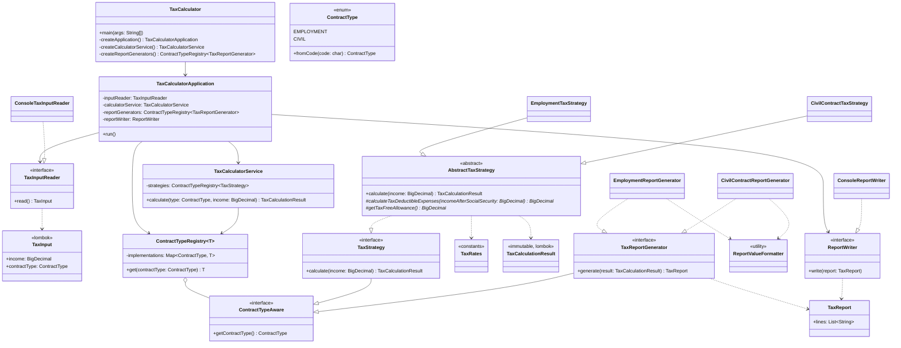

# Clean Code Refactoring Decision Log: TaxCalculator

This document tracks all design decisions, architectural improvements, and Clean Code principles applied during the refactoring of `TaxCalculator.java`.

---

## 1. Overview & Objectives

The original `TaxCalculator.java` implementation suffered from severe code smells, architectural anti-patterns, and compilation issues caused by hasty translation and copy-pasting.

### Core Problems Identified:
1. **Broken Compilation**: Duplicate declarations and syntax errors from bad find-replace operations (`advanceTaxPaidadvanceTax`, `soc_sick_secur`, missing `advanceTax` and `taxPaid`).
2. **Global Mutable State**: All calculations mutated 12 `public static` fields directly, introducing hidden side-effects, making thread-safety impossible, and preventing isolated testing.
3. **Floating-Point Inaccuracy**: Using `double` for currency and tax math risks IEEE 754 precision issues (e.g. `0.1 + 0.2 != 0.3`). Financial systems should always operate on exact numbers (`BigDecimal` or grosze).
4. **Boilerplate Clutter**: Large classes filled with manual getters, builders, and constructors distract from domain rules.
5. **Massive Main Method & God Method**: The `main` method spanned over 100 lines, doing input reading, input validation, math calculations, business logic branching, string formatting, and console output.
6. **Code Duplication (Violation of DRY)**: The Employment (`'E'`) and Civil (`'C'`) contract logic duplicated nearly 90% of identical calculation formulas and printing code.
7. **Violation of Open/Closed Principle (OCP)**: Adding any new contract type (e.g. B2B, Specific-Task / *Umowa o Dzieło*) required modifying giant nested `if-else` blocks in `main`.
8. **Magic Numbers**: Unexplained numeric literals (`9.76`, `1.5`, `2.45`, `9.0`, `7.75`, `18.0`, `111.25`, `46.33`, `20.0`) scattered throughout the code.
9. **Poor & Cryptic Naming**: Obscure identifiers (`isr`, `br`, `df00`, `df`, `soc_security`, `soc_health1`, `soc_health2`, `taxedIncome0`, `advanceTaxPaid0`, `d_income`).
10. **Tightly Coupled I/O and Business Logic**: Calculation code was interwoven with `System.in` and `System.out`, making pure unit testing impossible without standard stream redirection.
11. **Dead Code & Deprecated Shims**: Preserving unused legacy static fields and methods clutters the codebase with dead code.
12. **Redundant Comments**: Relying on comments rather than expressive code contradicts Clean Code.

---

## 2. Refactored Architecture

The refactored solution separates concerns into clean, modular layers following SOLID and Clean Code principles:



---

## 3. Detailed Decision Log

### Decision 1: Establishing Characterization Tests & Baseline Compilation Fixes

#### Context & Problem
The source code failed to compile with 13 errors caused by erroneous variable renames (`advanceTaxPaidadvanceTax`, `soc_sick_secur`, missing `advanceTax` and `taxPaid`, duplicate variable definition). Before refactoring, the code had to compile and its behavior needed to be locked down with automated regression tests.

#### Previous Code (Before)
```java
public static double advanceTaxPaidadvanceTax = 0;
public static double taxFreeIncome = 46.33;
public static double advanceTaxPaidadvanceTax = 0;
public static double advanceTaxPaid0 = 0;

double advanceTax;
System.out.println("Already paid tax = " + df00.format(taxPaid));

public static void calculateAdvanceTax() {
    advanceTaxPaidadvanceTax = advanceTax - soc_health2 - taxFreeIncome;
}

soc_sick_secur = (income * 2.45) / 100;
```

#### New Modified Code (After)
```java
public static double advanceTax = 0;
public static double taxFreeIncome = 46.33;
public static double advanceTaxPaid = 0;
public static double advanceTaxPaid0 = 0;

double taxPaid = advanceTax;

public static void calculateAdvanceTax() {
    advanceTaxPaid = advanceTax - soc_health2 - taxFreeIncome;
}

soc_sick_security = (income * 2.45) / 100;
```
Along with creating `TaxCalculatorTest.java` verifying that inputs `1000` and `5000` for contracts `'E'` and `'C'` output exact expected values.

#### Clean Code Principle & Rationale
- **Working Code First & Regression Safety**: A refactoring must never alter observable program behavior without intention. Automated tests form a safety net that guarantees zero regressions throughout all subsequent steps.

---

### Decision 2: Switching from Floating-Point (`double`) to Exact Arithmetic (`BigDecimal`)

#### Context & Problem
Floating-point arithmetic (`double`, `float`) is inherently prone to binary representation inaccuracies (IEEE 754), which can lead to off-by-one grosz rounding errors in tax calculations and financial ledgers. In enterprise and financial applications, money must always be represented either in whole minor units (grosze as integers) or via `BigDecimal` with explicit scale and rounding mode.

#### Previous Code (Before)
```java
public static double soc_security = 0;
soc_security = (income * 9.76) / 100;
double taxedIncome = income - taxDeductibleExpenses;
double taxedIncome0 = Double.parseDouble(df.format(taxedIncome));
```

#### New Modified Code (After)
```java
private static final int CURRENCY_SCALE = 2;
private static final int INTEGER_SCALE = 0;
private static final RoundingMode ROUNDING_MODE = RoundingMode.HALF_EVEN;

protected BigDecimal applyRate(BigDecimal amount, BigDecimal rate) {
    return amount.multiply(rate).setScale(CURRENCY_SCALE, ROUNDING_MODE);
}

protected BigDecimal roundToWhole(BigDecimal amount) {
    return amount.setScale(INTEGER_SCALE, ROUNDING_MODE);
}
```

#### Clean Code Principle & Rationale
- **Correctness & Precision**: `BigDecimal` guarantees arbitrary-precision signed decimals with explicit rounding semantics.
- **Explicit Rounding Modes**: Rather than relying on string-parsing through `Double.parseDouble(df.format(value))`, rounding is directly handled by `BigDecimal.setScale()`.

---

### Decision 3: Eliminating Boilerplate with Project Lombok

#### Context & Problem
Creating immutable domain models and data transfer objects in plain Java often generates hundreds of lines of boilerplate: private fields, constructors, getters, equals, hashCode, and builders. This boilerplate drowns the actual business logic and reduces readability.

#### Previous Code (Before)
```java
// TaxCalculationResult.java: 150 lines of boilerplate constructor and 18 getters
public class TaxCalculationResult {
    private final ContractType contractType;
    ...
    public TaxCalculationResult(ContractType contractType, ...) {
        this.contractType = contractType;
        ...
    }
    public ContractType getContractType() { return contractType; }
    ... (17 more getters)
}
```

#### New Modified Code (After)
```java
@Getter
@Builder
@AllArgsConstructor
public class TaxCalculationResult {
    private final ContractType contractType;
    private final BigDecimal grossIncome;
    private final BigDecimal pensionContribution;
    private final BigDecimal disabilityContribution;
    private final BigDecimal sicknessContribution;
    private final BigDecimal totalSocialSecurity;
    private final BigDecimal healthContributionBase;
    private final BigDecimal healthContribution;
    private final BigDecimal taxDeductibleHealthContribution;
    private final BigDecimal taxDeductibleExpenses;
    private final BigDecimal taxableBase;
    private final BigDecimal roundedTaxableBase;
    private final BigDecimal advanceTax;
    private final BigDecimal taxFreeAllowance;
    private final BigDecimal reducedTax;
    private final BigDecimal advanceTaxPaid;
    private final BigDecimal roundedAdvanceTaxPaid;
    private final BigDecimal netIncome;
}
```
Lombok is also applied to `ContractType` (`@Getter`, `@AllArgsConstructor`) and `InputData` (`@Getter`, `@AllArgsConstructor`).

#### Clean Code Principle & Rationale
- **Conciseness & High Signal-to-Noise Ratio**: Using Lombok annotations eliminates noisy boilerplate while keeping classes fully immutable, clear, and readable.

---

### Decision 4: Total Elimination of Dead Code & Deprecated Shims

#### Context & Problem
Initially, legacy static fields and methods were kept as `@Deprecated` backwards-compatibility shims. However, in clean codebases, dead code and unused backward-compatibility clutter should not be retained when refactoring internal designs. Git version control preserves history; code itself must remain clean, focused, and free of obsolete artifacts.

#### Previous Code (Before)
```java
@Deprecated public static double income = 0;
@Deprecated public static char contractType = ' ';
@Deprecated public static double soc_security = 0;
@Deprecated public static double soc_health_security = 0;
@Deprecated public static double soc_sick_security = 0;
@Deprecated public static double taxDeductibleExpenses = 111.25;
@Deprecated public static double soc_health1 = 0;
@Deprecated public static double soc_health2 = 0;
@Deprecated public static double advanceTax = 0;
@Deprecated public static double taxFreeIncome = 46.33;
@Deprecated public static double advanceTaxPaid = 0;
@Deprecated public static double advanceTaxPaid0 = 0;

@Deprecated public static void calculateAdvanceTax() { ... }
@Deprecated public static void calculateTax(double taxedIncome) { ... }
@Deprecated public static void calculateIncome(double grossIncome) { ... }
@Deprecated public static void calculateOtherTaxes(double basis) { ... }
```

#### New Modified Code (After)
All 12 deprecated static fields, the `populateLegacyFields` helper, and all 4 legacy mutation methods were completely deleted from `TaxCalculator.java`.

#### Clean Code Principle & Rationale
- **Clean Code Ch. 17 (G9: Dead Code)**: Dead code is code that is not executed or no longer needed. It creates unnecessary noise, confuses maintainers, and rots over time. Ruthlessly eliminate dead code.

---

### Decision 5: Code as Documentation — Complete Removal of Comments

#### Context & Problem
Comments frequently restate what clean code already expresses, or become stale and misleading when logic changes. In accordance with Clean Code principles, code should be so clean, intention-revealing, and expressive that comments become completely unnecessary.

#### Previous Code (Before)
```java
// Social Security (ZUS) contribution rates
public static final double PENSION_CONTRIBUTION_RATE = 9.76 / 100.0; // 9.76%

/**
 * Strategy interface defining tax calculation for a specific contract type.
 */
public interface TaxStrategy { ... }

// 1. Social security contributions
double pensionContribution = grossIncome * TaxRates.PENSION_CONTRIBUTION_RATE;
```

#### New Modified Code (After)
All comments (Javadoc, inline notes, section dividers) were completely removed across all classes. The code uses intention-revealing identifiers and single-responsibility classes:
```java
public final class TaxRates {
    private TaxRates() {}

    public static final BigDecimal PENSION_CONTRIBUTION_RATE = new BigDecimal("0.0976");
    public static final BigDecimal DISABILITY_CONTRIBUTION_RATE = new BigDecimal("0.0150");
    public static final BigDecimal SICKNESS_CONTRIBUTION_RATE = new BigDecimal("0.0245");
...
```

#### Clean Code Principle & Rationale
- **Clean Code Ch. 4 (Comments)**: "Don't comment bad code — rewrite it." (Brian W. Kernighan and P. J. Plaugher).
- A comment is often a failure to express the intent through clean code. If class, method, and variable names are chosen properly, comments are redundant clutter.

---

### Decision 6: Replacing Magic Numbers with Named Domain Constants (`TaxRates.java`)

#### Context & Problem
Raw numbers (`0.0976`, `0.0150`, `0.0245`, `0.0900`, `0.0775`, `0.18`, `111.25`, `46.33`, `0.20`) were hardcoded across multiple calculations and duplicated between contract blocks.

#### Previous Code (Before)
```java
soc_security = (income * 9.76) / 100;
soc_health_security = (income * 1.5) / 100;
soc_sick_security = (income * 2.45) / 100;
soc_health1 = (income * 9) / 100;
soc_health2 = (income * 7.75) / 100;
taxDeductibleExpenses = 111.25;
taxDeductibleExpenses = (income * 20) / 100;
advanceTax = (income * 18) / 100;
```

#### New Modified Code (After)
```java
public final class TaxRates {
    private TaxRates() {}

    public static final BigDecimal PENSION_CONTRIBUTION_RATE = new BigDecimal("0.0976");
    public static final BigDecimal DISABILITY_CONTRIBUTION_RATE = new BigDecimal("0.0150");
    public static final BigDecimal SICKNESS_CONTRIBUTION_RATE = new BigDecimal("0.0245");

    public static final BigDecimal HEALTH_CONTRIBUTION_RATE = new BigDecimal("0.0900");
    public static final BigDecimal TAX_DEDUCTIBLE_HEALTH_RATE = new BigDecimal("0.0775");

    public static final BigDecimal ADVANCE_TAX_RATE = new BigDecimal("0.18");

    public static final BigDecimal STANDARD_EMPLOYMENT_EXPENSES = new BigDecimal("111.25");
    public static final BigDecimal EMPLOYMENT_TAX_FREE_ALLOWANCE = new BigDecimal("46.33");

    public static final BigDecimal CIVIL_EXPENSES_PERCENTAGE = new BigDecimal("0.20");
    public static final BigDecimal CIVIL_TAX_FREE_ALLOWANCE = new BigDecimal("0.00");
}
```

#### Clean Code Principle & Rationale
- **Clean Code Ch. 17 (G25: Replace Magic Numbers with Named Constants)**: Unnamed numbers obscure developer intent. Giving each rate a domain-explicit name turns mysterious math into readable statutory rules.
- **Single Source of Truth**: Centralizing tax rates ensures updating statutory parameters happens in exactly one place.

---

### Decision 7: Replacing Primitive Contract Codes with `ContractType` Enum

#### Context & Problem
Contract types were represented as primitive character literals (`'E'`, `'C'`). If the user entered an invalid character, the program fell into an `else` branch, or error handling was fragile.

#### Previous Code (Before)
```java
public static char contractType = ' ';
...
contractType = br.readLine().charAt(0);
if (contractType == 'E') { ... }
else if (contractType == 'C') { ... }
else { System.out.println("Unknown type of contract!"); }
```

#### New Modified Code (After)
```java
@Getter
@AllArgsConstructor
public enum ContractType {
    EMPLOYMENT('E', "EMPLOYMENT"),
    CIVIL('C', "CIVIL");

    private final char code;
    private final String description;

    public static ContractType fromCode(char code) {
        char upperCode = Character.toUpperCase(code);
        for (ContractType type : values()) {
            if (type.code == upperCode) {
                return type;
            }
        }
        throw new IllegalArgumentException("Unknown contract type code: " + code);
    }
}
```

#### Clean Code Principle & Rationale
- **Type Safety**: Enums eliminate primitive obsession, enforce valid states at compile time, and provide centralized validation.

---

### Decision 8: Eliminating Duplication & Applying the Strategy Pattern (DRY & OCP)

#### Context & Problem
`contractType == 'E'` and `contractType == 'C'` branches duplicated 90% of their logic. Adding a new contract type (e.g. B2B, task contract) would require copying another 40 lines of code into a nested `else if`.

#### Previous Code (Before)
```java
if (contractType == 'E') {
    // 45 lines calculating social security, health tax, advance tax, net income, and printing
} else if (contractType == 'C') {
    // 45 lines doing the exact same sequence of math with 2 minor differences
}
```

#### New Modified Code (After)
1. **Strategy Interface** (`TaxStrategy.java`):
```java
public interface TaxStrategy {
    ContractType getContractType();
    TaxCalculationResult calculate(BigDecimal grossIncome);
}
```

2. **Template Method Base Strategy** (`AbstractTaxStrategy.java`):
Encapsulates common calculation steps, delegating only contract-specific variations:
```java
public abstract class AbstractTaxStrategy implements TaxStrategy {
    @Override
    public TaxCalculationResult calculate(BigDecimal grossIncome) {
        BigDecimal pensionContribution = applyRate(grossIncome, TaxRates.PENSION_CONTRIBUTION_RATE);
        ...
        BigDecimal taxDeductibleExpenses = calculateTaxDeductibleExpenses(grossIncome);
        ...
        BigDecimal taxFreeAllowance = getTaxFreeAllowance();
        ...
        return TaxCalculationResult.builder()...build();
    }

    protected abstract BigDecimal calculateTaxDeductibleExpenses(BigDecimal grossIncome);
    protected abstract BigDecimal getTaxFreeAllowance();
}
```

3. **Concrete Strategies** (`EmploymentTaxStrategy.java`, `CivilContractTaxStrategy.java`):
Each strategy is concise (~15 lines):
```java
public class EmploymentTaxStrategy extends AbstractTaxStrategy {
    @Override public ContractType getContractType() { return ContractType.EMPLOYMENT; }
    @Override protected BigDecimal calculateTaxDeductibleExpenses(BigDecimal income) { return TaxRates.STANDARD_EMPLOYMENT_EXPENSES; }
    @Override protected BigDecimal getTaxFreeAllowance() { return TaxRates.EMPLOYMENT_TAX_FREE_ALLOWANCE; }
}

public class CivilContractTaxStrategy extends AbstractTaxStrategy {
    @Override public ContractType getContractType() { return ContractType.CIVIL; }
    @Override protected BigDecimal calculateTaxDeductibleExpenses(BigDecimal income) { return applyRate(income, TaxRates.CIVIL_EXPENSES_PERCENTAGE); }
    @Override protected BigDecimal getTaxFreeAllowance() { return TaxRates.CIVIL_TAX_FREE_ALLOWANCE; }
}
```

4. **Service Dispatcher** (`TaxCalculatorService.java`):
```java
public class TaxCalculatorService {
    private final Map<ContractType, TaxStrategy> strategies = new EnumMap<>(ContractType.class);

    public TaxCalculatorService() {
        registerStrategy(new EmploymentTaxStrategy());
        registerStrategy(new CivilContractTaxStrategy());
    }

    public void registerStrategy(TaxStrategy strategy) {
        strategies.put(strategy.getContractType(), strategy);
    }

    public TaxCalculationResult calculate(ContractType contractType, BigDecimal grossIncome) {
        if (grossIncome == null || grossIncome.compareTo(BigDecimal.ZERO) < 0) {
            throw new IllegalArgumentException("Income cannot be negative or null");
        }
        TaxStrategy strategy = strategies.get(contractType);
        if (strategy == null) {
            throw new IllegalArgumentException("No tax calculation strategy registered for contract type: " + contractType);
        }
        return strategy.calculate(grossIncome);
    }
}
```

#### Clean Code Principle & Rationale
- **Open/Closed Principle (OCP)**: Adding a new contract type requires zero modification to existing strategies or calculation services. One simply registers a new `TaxStrategy` implementation.
- **Don't Repeat Yourself (DRY)**: Centralized shared tax computation in `AbstractTaxStrategy`.

---

### Decision 9: Separation of Concerns (Business Logic vs Presentation & I/O)

#### Context & Problem
Console I/O (`System.in`, `System.out`), stream parsing, number formatting, math calculations, and exception handling were all entangled in a single monolithic method.

#### Previous Code (Before)
```java
public static void main(String[] args) {
    // Monolithic method: 110 lines doing I/O, math, string concatenation, and error handling
}
```

#### New Modified Code (After)
1. **Presentation Layer** (`TaxReportPrinter.java`):
Encapsulates all string formatting and console printing:
```java
public class TaxReportPrinter {
    public void printReport(TaxCalculationResult result) {
        if (result.getContractType() == ContractType.EMPLOYMENT) {
            printEmploymentReport(result);
        } else if (result.getContractType() == ContractType.CIVIL) {
            printCivilReport(result);
        } else {
            out.println("Unknown type of contract!");
        }
    }
}
```

2. **Clean Entry Point Coordinator** (`TaxCalculator.java`):
The `main` method is reduced to 14 readable lines:
```java
public static void main(String[] args) {
    try {
        InputData input = readInput();

        TaxCalculatorService service = new TaxCalculatorService();
        TaxCalculationResult result = service.calculate(input.getContractType(), input.getIncome());

        TaxReportPrinter printer = new TaxReportPrinter();
        printer.printReport(result);
    } catch (Exception ex) {
        System.out.println("Incorrect");
        System.err.println(ex);
    }
}
```

#### Clean Code Principle & Rationale
- **Single Responsibility Principle (SRP)**: Each class now has only one reason to change:
  - `TaxCalculator`: CLI lifecycle and coordination.
  - `TaxCalculatorService` & strategies: Tax math and contribution calculation.
  - `TaxReportPrinter`: Presentation and formatting of report strings.
  - `TaxRates`: Statutory percentages and legal limits.

---

### Decision 10: Modular Subpackage Architecture (High Cohesion & Low Coupling)

#### Context & Problem
Keeping all classes in a single flat directory mixes domain models, presentation views, business calculation strategies, and service dispatchers. As projects grow, flat directory structures hinder cognitive navigation, reduce modularity, and violate the principle of organizing code by responsibilities.

#### Previous Code (Before)
All classes located in a single flat directory:
```
SEM/
├── ContractType.java
├── TaxRates.java
├── TaxCalculationResult.java
├── TaxStrategy.java
├── AbstractTaxStrategy.java
├── EmploymentTaxStrategy.java
├── CivilContractTaxStrategy.java
├── TaxCalculatorService.java
├── TaxReportPrinter.java
└── TaxCalculator.java
```

#### New Modified Code (After)
Code organized into focused, cohesive subpackages:
```
SEM/
├── model/
│   ├── ContractType.java
│   ├── TaxCalculationResult.java
│   └── TaxRates.java
├── strategy/
│   ├── TaxStrategy.java
│   ├── AbstractTaxStrategy.java
│   ├── EmploymentTaxStrategy.java
│   └── CivilContractTaxStrategy.java
├── service/
│   └── TaxCalculatorService.java
├── view/
│   └── TaxReportPrinter.java
├── lib/
│   └── lombok.jar
├── TaxCalculator.java
├── TaxCalculatorTest.java
└── REFACTORING_DECISIONS.md
```

#### Clean Code Principle & Rationale
- **Package Cohesion & Modularity**: Grouping classes by architectural role (`model`, `strategy`, `service`, `view`) establishes clear architectural boundaries and makes the system intuitive to explore.
- **Dependency Inversion & Encapsulation**: High-level modules depend on abstractions (`TaxStrategy`), and presentation concerns (`view`) are cleanly isolated from computation (`service`, `strategy`).

---

### Iteration 2 — Scope Agreed After Review

After the first iteration the codebase was reviewed again against Clean Code. The proposals and their outcome:

| Proposal | Outcome |
|---|---|
| Standard Maven build, `src/main/java` / `src/test/java` layout, no binaries or IDE files in Git | **Accepted** → Decision 11 |
| Replace the hand-made test runner with JUnit 5 | **Accepted** → Decision 12 |
| Replace Lombok with Java `record`s | **Rejected** — Lombok stays, Decision 3 remains valid |
| Dedicated CLI / input-reader layer, finer exception handling in `main` | **Rejected** — current input and error handling in `main` are sufficient |
| Inject strategies into `TaxCalculatorService` instead of creating them inside | **Accepted** → Decision 13 |
| Composition instead of Template Method inheritance, splitting `AbstractTaxStrategy.calculate()` | **Deferred** — no decision yet |
| Independent report printer per contract scenario | **Accepted** → Decision 14 |
| Calculations compliant with Polish tax rules | **Accepted** → Decision 15 |
| "No comments" rule (Decision 5) | **Reaffirmed** — code must be readable without comments |

---

### Decision 11: Standard Maven Build & Directory Layout

#### Context & Problem
- There was no build tool. Compilation required a hand-written `javac` command with a committed `lib/lombok.jar` on the classpath and processor path.
- Package declarations (`com.bartoszwalter.students.taxes.model`) did not match the directories (`model/`). The project worked only in IntelliJ, thanks to `packagePrefix` in `SEM.iml`.
- A 2 MB binary (`lib/lombok.jar`) was committed although `.gitignore` excludes `*.jar`, together with machine-specific IDE files (`.idea/`, `SEM.iml`, JDK name `ms-21`).
- Test code lived next to production code in the source root.

#### Previous Code (Before)
```
taxcalculator/
├── .idea/
├── SEM.iml
├── lib/lombok.jar
├── model/  strategy/  service/  view/
├── TaxCalculator.java
└── TaxCalculatorTest.java
```
```bash
javac -cp "lib/lombok.jar" -processorpath "lib/lombok.jar" -d . model/*.java strategy/*.java service/*.java view/*.java TaxCalculator.java TaxCalculatorTest.java
```

#### New Modified Code (After)
```
taxcalculator/
├── pom.xml
├── src/main/java/com/bartoszwalter/students/taxes/
│   ├── TaxCalculator.java
│   └── model/  strategy/  service/  view/
└── src/test/java/com/bartoszwalter/students/taxes/
    ├── TaxCalculatorTest.java
    └── model/  strategy/  service/  view/
```
```xml
<properties>
    <maven.compiler.release>17</maven.compiler.release>
    <lombok.version>1.18.36</lombok.version>
    <junit.version>5.12.2</junit.version>
    <assertj.version>3.27.4</assertj.version>
</properties>

<dependency>
    <groupId>org.projectlombok</groupId>
    <artifactId>lombok</artifactId>
    <version>${lombok.version}</version>
    <scope>provided</scope>
</dependency>
```
Lombok is registered in `maven-compiler-plugin` `annotationProcessorPaths`. All plugin versions are pinned. Files were moved with `git mv` to keep their history. `.gitignore` now also excludes `target/`, `.idea/`, `*.iml` and `out/`.

#### Clean Code Principle & Rationale
- **Clean Code Ch. 17 (E1: Build Requires More Than One Step, E2: Tests Require More Than One Step)**: building and testing is one trivial command — `mvn test`.
- **Declared, versioned dependencies**: libraries come from the repository manager, not from binaries copied into Git.
- **IDE independence**: IntelliJ, Eclipse and VS Code import `pom.xml` directly; no IDE metadata is needed to understand the structure.
- **Directory = package**: the layout is navigable without tooling.
- **Java 17** (LTS, installed JDK); the code also compiles on Java 21.

---

### Decision 12: JUnit 5 + AssertJ Test Suite

#### Context & Problem
- `TaxCalculatorTest` was a `main()` method with hand-made `assertEquals` / `assertContains`. The first failure aborted the whole run, an empty `catch` block hid the intent, and `assertEquals(actual, expected)` reversed the conventional argument order.
- Output assertions checked prefixes only: `"Social security tax 97"` passed for `97.60`, `97,60` and `97.99`.
- Missing cases: rounding boundaries, zero income, negative income (claimed in section 4 but never tested), lowercase contract codes, invalid input.

#### Previous Code (Before)
```java
public static void main(String[] args) {
    testDirectServiceCalculations();
    testEmploymentContractWith1000();
    ...
}

private static void testInvalidContractThrowsException() {
    try {
        ContractType.fromCode('Z');
        throw new AssertionError("Expected IllegalArgumentException for unknown contract code 'Z'");
    } catch (IllegalArgumentException expected) {
    }
}

assertContains(output, "Social security tax 97");
```

#### New Modified Code (After)
One test class per production class — 9 classes, 51 tests:
```java
@ParameterizedTest
@CsvSource({"E, EMPLOYMENT", "e, EMPLOYMENT", "C, CIVIL", "c, CIVIL"})
void resolvesContractTypeFromCodeIgnoringCase(char code, ContractType expectedType) {
    assertThat(ContractType.fromCode(code)).isEqualTo(expectedType);
}

@Test
void rejectsUnknownCode() {
    assertThatThrownBy(() -> ContractType.fromCode('Z'))
            .isInstanceOf(IllegalArgumentException.class)
            .hasMessageContaining("Z");
}
```
Report printers are verified against the complete report, line by line:
```java
assertThat(output.toString(StandardCharsets.UTF_8).lines()).containsExactly(
        "EMPLOYMENT",
        "Income 1000.00",
        ...
        "Net income = 763.24");
```
`TaxCalculatorTest` remains a thin end-to-end test of `main`: both contract types plus invalid input (non-numeric income, negative income, unknown code, empty code).

#### Clean Code Principle & Rationale
- **Clean Code Ch. 9 (Unit Tests)**: F.I.R.S.T. — independent, repeatable, self-validating tests; one concept per test; test names describe behavior.
- **Clean Code Ch. 17 (T1: Insufficient Tests, T5: Test Boundary Conditions)**: rounding at `.50`, zero income, expenses exceeding income and allowance exceeding tax are covered explicitly.
- **Money compared by value**: `isEqualByComparingTo` is independent of `BigDecimal` scale (`0` vs `0.00`).

---

### Decision 13: Constructor Injection of Strategies & `ContractTypeRegistry`

#### Context & Problem
`TaxCalculatorService` created concrete strategies itself and exposed a public mutator `registerStrategy`. The service depended on concrete classes (DIP violation), could be changed after construction, and adding a contract type meant editing the service — contradicting the OCP claim of Decision 8. The same "contract type → implementation" lookup was also needed for report printers (Decision 14).

#### Previous Code (Before)
```java
public TaxCalculatorService() {
    registerStrategy(new EmploymentTaxStrategy());
    registerStrategy(new CivilContractTaxStrategy());
}

public void registerStrategy(TaxStrategy strategy) {
    strategies.put(strategy.getContractType(), strategy);
}

public TaxCalculationResult calculate(ContractType contractType, BigDecimal grossIncome) {
    ...
    TaxStrategy strategy = strategies.get(contractType);
    if (strategy == null) {
        throw new IllegalArgumentException("No tax calculation strategy registered for contract type: " + contractType);
    }
    return strategy.calculate(grossIncome);
}
```

#### New Modified Code (After)
```java
public interface ContractTypeAware {

    ContractType getContractType();
}

public final class ContractTypeRegistry<T extends ContractTypeAware> {

    private final Map<ContractType, T> implementations = new EnumMap<>(ContractType.class);

    public ContractTypeRegistry(Collection<? extends T> implementations) {
        implementations.forEach(this::register);
    }

    public T get(ContractType contractType) {
        T implementation = implementations.get(contractType);
        if (implementation == null) {
            throw new IllegalArgumentException("No implementation registered for contract type: " + contractType);
        }
        return implementation;
    }

    private void register(T implementation) {
        ContractType contractType = implementation.getContractType();
        if (implementations.putIfAbsent(contractType, implementation) != null) {
            throw new IllegalArgumentException("Duplicate implementation registered for contract type: " + contractType);
        }
    }
}

public interface TaxStrategy extends ContractTypeAware {

    TaxCalculationResult calculate(BigDecimal grossIncome);
}

public class TaxCalculatorService {

    private final ContractTypeRegistry<TaxStrategy> strategies;

    public TaxCalculatorService(Collection<? extends TaxStrategy> strategies) {
        this.strategies = new ContractTypeRegistry<>(strategies);
    }

    public TaxCalculationResult calculate(ContractType contractType, BigDecimal grossIncome) {
        if (grossIncome == null || grossIncome.signum() < 0) {
            throw new IllegalArgumentException("Income cannot be negative or null");
        }

        return strategies.get(contractType).calculate(grossIncome);
    }
}
```
The object graph is assembled in one place, `main`, which acts as the composition root:
```java
private static TaxCalculatorService createCalculatorService() {
    return new TaxCalculatorService(List.of(
            new EmploymentTaxStrategy(),
            new CivilContractTaxStrategy()));
}
```

#### Clean Code Principle & Rationale
- **Dependency Inversion Principle**: the service depends only on the `TaxStrategy` abstraction.
- **Open/Closed Principle** (corrects the claim of Decision 8): a new contract type needs a new enum constant, a new `TaxStrategy` and a new `TaxReportPrinter`, registered in `main`. The service, the registry and the existing strategies and printers stay untouched.
- **Clean Code Ch. 11 (Systems — Separate Constructing a System from Using It)**: construction lives in `main`, use lives in the service.
- **Immutability & fail fast**: no public mutators; a duplicate registration throws instead of silently overwriting.
- **DRY**: one registry serves both strategies and printers.

---

### Decision 14: Independent Report Printer per Contract Scenario

#### Context & Problem
- `TaxReportPrinter` branched on `ContractType` with `if/else` — the same conditional the Strategy pattern removed from the calculations. The `else "Unknown type of contract!"` branch was unreachable dead code, and every new contract type required editing the class.
- `DecimalFormat("#.00")` used the default locale: on a Polish system amounts were printed as `97,60`, while `BigDecimal.toString()` printed `160.02` in the same report. `#.00` printed `.50` for amounts below 1 PLN, and some amounts were not formatted at all (`Income 1000`).
- Rates were hard-coded in labels (`"18 %"`, `"9%"`, `"7,75%"`), duplicating `TaxRates`.
- The 1.5% disability contribution (*składka rentowa*) was labelled "Health social security tax" — a translation error.

#### Previous Code (Before)
```java
public void printReport(TaxCalculationResult result) {
    if (result.getContractType() == ContractType.EMPLOYMENT) {
        printEmploymentReport(result);
    } else if (result.getContractType() == ContractType.CIVIL) {
        printCivilReport(result);
    } else {
        out.println("Unknown type of contract!");
    }
}

out.println("Health social security tax    " + currencyFormat.format(result.getDisabilityContribution()));
out.println("Advance tax 18 % = " + result.getAdvanceTax());
```

#### New Modified Code (After)
```java
public interface TaxReportPrinter extends ContractTypeAware {

    void print(TaxCalculationResult result);
}

@RequiredArgsConstructor
public class EmploymentReportPrinter implements TaxReportPrinter {

    private final PrintStream out;

    @Override
    public ContractType getContractType() {
        return ContractType.EMPLOYMENT;
    }

    @Override
    public void print(TaxCalculationResult result) {
        out.println("EMPLOYMENT");
        out.println("Income " + formatAmount(result.getGrossIncome()));
        out.println("Social security tax " + formatAmount(result.getPensionContribution()));
        out.println("Disability social security tax " + formatAmount(result.getDisabilityContribution()));
        ...
        out.println("Advance tax " + formatRate(TaxRates.ADVANCE_TAX_RATE) + " = " + formatAmount(result.getAdvanceTax()));
        ...
    }
}
```
`CivilContractReportPrinter` follows the same shape with the civil-contract labels. Formatting is centralized and independent of the locale:
```java
public final class ReportValueFormatter {

    public static String formatAmount(BigDecimal amount) {
        return amount.setScale(AMOUNT_SCALE, ROUNDING_MODE).toPlainString();
    }

    public static String formatWholeAmount(BigDecimal amount) {
        return amount.setScale(WHOLE_AMOUNT_SCALE, ROUNDING_MODE).toPlainString();
    }

    public static String formatRate(BigDecimal rate) {
        return rate.movePointRight(RATE_TO_PERCENT_SHIFT).stripTrailingZeros().toPlainString() + PERCENT_SIGN;
    }
}
```
The printer is selected with the same registry as the strategies:
```java
createReportPrinters().get(result.getContractType()).print(result);
```

#### Clean Code Principle & Rationale
- **SRP / OCP**: each printer has exactly one reason to change — the report layout of its scenario. A new scenario is a new printer; existing printers are not edited.
- **Clean Code Ch. 17 (G23: Prefer Polymorphism to If/Else or Switch/Case, G9: Dead Code)**: the type check and the unreachable branch are gone.
- **Single source of truth (G25)**: the percentages shown in labels are derived from `TaxRates`.
- **Consistent, correct output**: every amount has 2 decimals and a `.` separator regardless of locale; rounded amounts have none. The mislabelled contribution and whitespace typos (`"Advance tax  = "`) are fixed. The civil report's "Already paid tax" shows `reducedTax` (tax after allowance), which is what the label describes.
- **Lombok kept (Decision 3)**: `@RequiredArgsConstructor` injects the `PrintStream`. `ReportValueFormatter` is a plain final class rather than Lombok `@UtilityClass`, because javac cannot static-import members of a `@UtilityClass`.

---

### Decision 15: Calculations Compliant with Polish Tax Rules

#### Context & Problem
The first iteration preserved the arithmetic of the (non-compiling) original, including domain errors introduced during its translation:
1. **Health contribution base equal to gross income.** In the original, `d_income = calculateIncome(income)` (income after social security) was computed but never used in the employment branch, and the civil branch tried to shadow `income` with it (`double income = calculateIncome(income);` — a compile error not described in Decision 1). Under Polish rules the base for the health contribution and for tax-deductible expenses is gross income **minus social security contributions** (*przychód pomniejszony o składki na ubezpieczenia społeczne*).
2. **Civil-contract expenses computed as 20% of gross income** instead of 20% of income after social security contributions.
3. **`RoundingMode.HALF_EVEN` (banker's rounding).** *Ordynacja podatkowa*, art. 63 § 1: tax bases and taxes are rounded to full złoty — below 50 groszy down, 50 groszy and more up, i.e. `HALF_UP`. Contributions are rounded to the grosz the same way.
4. **Negative values for low incomes.** The taxable base, the tax after allowance and the advance tax payable could become negative. A tax base and a tax cannot be negative, and the deductible part of the health contribution can lower the advance tax only down to zero.

#### Previous Code (Before)
```java
private static final RoundingMode ROUNDING_MODE = RoundingMode.HALF_EVEN;

BigDecimal healthContributionBase = grossIncome;
BigDecimal healthContribution = applyRate(healthContributionBase, TaxRates.HEALTH_CONTRIBUTION_RATE);
BigDecimal taxDeductibleHealthContribution = applyRate(healthContributionBase, TaxRates.TAX_DEDUCTIBLE_HEALTH_RATE);

BigDecimal taxDeductibleExpenses = calculateTaxDeductibleExpenses(grossIncome);
BigDecimal taxableBase = grossIncome.subtract(taxDeductibleExpenses);
...
BigDecimal reducedTax = advanceTax.subtract(taxFreeAllowance);
BigDecimal advanceTaxPaid = advanceTax.subtract(taxDeductibleHealthContribution).subtract(taxFreeAllowance);
...
BigDecimal netIncome = grossIncome.subtract(totalSocialSecurity.add(healthContribution).add(roundedAdvanceTaxPaid));
```

#### New Modified Code (After)
```java
private static final RoundingMode ROUNDING_MODE = RoundingMode.HALF_UP;

BigDecimal totalSocialSecurity = pensionContribution.add(disabilityContribution).add(sicknessContribution);

BigDecimal incomeAfterSocialSecurity = grossIncome.subtract(totalSocialSecurity);
BigDecimal healthContribution = applyRate(incomeAfterSocialSecurity, TaxRates.HEALTH_CONTRIBUTION_RATE);
BigDecimal taxDeductibleHealthContribution = applyRate(incomeAfterSocialSecurity, TaxRates.TAX_DEDUCTIBLE_HEALTH_RATE);

BigDecimal taxDeductibleExpenses = calculateTaxDeductibleExpenses(incomeAfterSocialSecurity);
BigDecimal taxableBase = nonNegative(incomeAfterSocialSecurity.subtract(taxDeductibleExpenses));
BigDecimal roundedTaxableBase = roundToWhole(taxableBase);

BigDecimal advanceTax = applyRate(roundedTaxableBase, TaxRates.ADVANCE_TAX_RATE);
BigDecimal taxFreeAllowance = getTaxFreeAllowance();
BigDecimal reducedTax = nonNegative(advanceTax.subtract(taxFreeAllowance));

BigDecimal advanceTaxPaid = nonNegative(reducedTax.subtract(taxDeductibleHealthContribution));
BigDecimal roundedAdvanceTaxPaid = roundToWhole(advanceTaxPaid);

BigDecimal netIncome = incomeAfterSocialSecurity.subtract(healthContribution).subtract(roundedAdvanceTaxPaid);
```
```java
protected abstract BigDecimal calculateTaxDeductibleExpenses(BigDecimal incomeAfterSocialSecurity);
```

#### Impact on Results (gross income 1000.00 PLN)
| Value | Employment before | Employment after | Civil before | Civil after |
|---|---|---|---|---|
| Health contribution base | 1000.00 | 862.90 | 1000.00 | 862.90 |
| Health contribution 9% | 90.00 | 77.66 | 90.00 | 77.66 |
| Tax-deductible expenses | 111.25 | 111.25 | 200.00 | 172.58 |
| Taxable base (rounded) | 889 | 752 | 800 | 690 |
| Advance tax payable (rounded) | 36 | 22 | 66 | 57 |
| **Net income** | **736.90** | **763.24** | **706.90** | **728.24** |

#### Clean Code Principle & Rationale
- **Correctness over preserved defects**: refactoring keeps behavior, but here the preserved behavior was a defect. The change is a deliberate, documented behavior change, kept separate from the structural refactoring and pinned by tests (`EmploymentTaxStrategyTest`, `CivilContractTaxStrategyTest`).
- **Intention-revealing names (Ch. 2)**: `incomeAfterSocialSecurity` says what the base is, replacing the misleading `healthContributionBase = grossIncome`.
- **Boundary conditions (T5)**: `1000.98` → taxable base `752.50` → `753`; `300.00` → allowance exceeds tax → `0`; `100.00` → expenses exceed income → base `0`.
- Supersedes the `HALF_EVEN` rounding mode of Decision 2. The statutory parameters of the kata (rates, 111.25 PLN, 46.33 PLN) are unchanged.

---

### Iteration 3 — Pluggable Input and Output

The user decided that both where the data comes from and where the report goes must be replaceable — the console is only today's choice; a file, a GUI or a web endpoint may follow. This revises the iteration 2 entry "Dedicated CLI / input-reader layer — Rejected": input is now abstracted, while the error handling in `main` stays as it was.

---

### Decision 16: Input Source Behind the `TaxInputReader` Abstraction

#### Context & Problem
`TaxCalculator.readInput()` read directly from `System.in` and wrote prompts directly to `System.out`. Reading income and contract type from any other source (file, GUI form, program arguments, HTTP request) meant rewriting `main`. The input value object `InputData` was a private nested class, invisible to anything but `main`.

#### Previous Code (Before)
```java
private static InputData readInput() throws IOException {
    BufferedReader reader = new BufferedReader(new InputStreamReader(System.in));

    System.out.print("Enter income: ");
    BigDecimal incomeInput = new BigDecimal(reader.readLine().trim());

    System.out.print("Contract Type: (E)mployment, (C)ivil: ");
    char contractCode = reader.readLine().trim().charAt(0);

    ContractType type = ContractType.fromCode(contractCode);
    return new InputData(incomeInput, type);
}

@Getter
@AllArgsConstructor
private static class InputData {
    private final BigDecimal income;
    private final ContractType contractType;
}
```

#### New Modified Code (After)
```java
@Getter
@AllArgsConstructor
public class TaxInput {

    private final BigDecimal income;
    private final ContractType contractType;
}

public interface TaxInputReader {

    TaxInput read();
}

public class ConsoleTaxInputReader implements TaxInputReader {

    private final BufferedReader reader;
    private final PrintStream promptOutput;

    public ConsoleTaxInputReader(InputStream input, PrintStream promptOutput) {
        this.reader = new BufferedReader(new InputStreamReader(input));
        this.promptOutput = promptOutput;
    }

    @Override
    public TaxInput read() {
        promptOutput.print("Enter income: ");
        BigDecimal income = new BigDecimal(readLine());

        promptOutput.print("Contract Type: (E)mployment, (C)ivil: ");
        ContractType contractType = ContractType.fromCode(readLine().charAt(0));

        return new TaxInput(income, contractType);
    }

    private String readLine() {
        try {
            return reader.readLine().trim();
        } catch (IOException ex) {
            throw new UncheckedIOException(ex);
        }
    }
}
```

#### Clean Code Principle & Rationale
- **Dependency Inversion / Open-Closed**: the application depends on `TaxInputReader`; a new source is one new implementation, nothing else changes.
- **Clean Code Ch. 8 (Boundaries)**: the console is a boundary; its details (`BufferedReader`, prompts, `IOException`) are kept in one adapter class.
- **Interface free of a specific technology**: `read()` declares no `IOException`, because sources such as program arguments or a GUI form do not perform stream I/O; the console adapter wraps it in `UncheckedIOException`.
- **Testability**: the console reader is tested with in-memory streams; the rest of the application is tested with a lambda `() -> input`.

---

### Decision 17: Report Content Separated from Output Destination

#### Context & Problem
After Decision 14 every printer both decided **what** the report contains and **where** it goes (`PrintStream`). Sending the same report to a file, a GUI or an HTTP response would have required duplicating every printer per destination — M contract types × N destinations.

#### Previous Code (Before)
```java
public interface TaxReportPrinter extends ContractTypeAware {

    void print(TaxCalculationResult result);
}

@RequiredArgsConstructor
public class EmploymentReportPrinter implements TaxReportPrinter {

    private final PrintStream out;

    @Override
    public void print(TaxCalculationResult result) {
        out.println("EMPLOYMENT");
        out.println("Income " + formatAmount(result.getGrossIncome()));
        ...
    }
}
```

#### New Modified Code (After)
Report generators (one per contract type) build the content:
```java
@Getter
public class TaxReport {

    private final List<String> lines;

    public TaxReport(List<String> lines) {
        this.lines = List.copyOf(lines);
    }
}

public interface TaxReportGenerator extends ContractTypeAware {

    TaxReport generate(TaxCalculationResult result);
}

public class EmploymentReportGenerator implements TaxReportGenerator {

    @Override
    public TaxReport generate(TaxCalculationResult result) {
        return new TaxReport(List.of(
                "EMPLOYMENT",
                "Income " + formatAmount(result.getGrossIncome()),
                ...
                "Net income = " + formatAmount(result.getNetIncome())));
    }
}
```
Report writers (one per destination) deliver it:
```java
public interface ReportWriter {

    void write(TaxReport report);
}

@RequiredArgsConstructor
public class ConsoleReportWriter implements ReportWriter {

    private final PrintStream out;

    @Override
    public void write(TaxReport report) {
        report.getLines().forEach(out::println);
    }
}
```
Classes were renamed with `git mv` (`*ReportPrinter` → `*ReportGenerator`) to keep history.

#### Clean Code Principle & Rationale
- **Single Responsibility Principle**: a generator changes when the report layout of its contract changes; a writer changes when the destination changes. Before, both reasons met in one class.
- **M + N instead of M × N**: a new contract type adds one generator, a new destination adds one writer.
- **Immutability**: `TaxReport` copies its lines (`List.copyOf`), so a writer cannot modify a generated report.
- **Pure, stream-free tests**: generators are verified directly on `getLines()`; only `ConsoleReportWriterTest` uses a stream.

---

### Decision 18: Application Flow in `TaxCalculatorApplication`, `main` as Composition Root

#### Context & Problem
`main` mixed two roles: choosing concrete implementations (console, strategies, printers) and running the flow read → calculate → report. Testing the flow required redirecting `System.in` and `System.out`.

#### Previous Code (Before)
```java
public static void main(String[] args) {
    try {
        InputData input = readInput();

        TaxCalculationResult result = createCalculatorService().calculate(input.getContractType(), input.getIncome());

        createReportPrinters().get(result.getContractType()).print(result);

    } catch (Exception ex) {
        System.out.println("Incorrect");
        System.err.println(ex);
    }
}
```

#### New Modified Code (After)
```java
@RequiredArgsConstructor
public class TaxCalculatorApplication {

    private final TaxInputReader inputReader;
    private final TaxCalculatorService calculatorService;
    private final ContractTypeRegistry<TaxReportGenerator> reportGenerators;
    private final ReportWriter reportWriter;

    public void run() {
        TaxInput input = inputReader.read();

        TaxCalculationResult result = calculatorService.calculate(input.getContractType(), input.getIncome());

        reportWriter.write(reportGenerators.get(result.getContractType()).generate(result));
    }
}

public static void main(String[] args) {
    try {
        createApplication().run();
    } catch (Exception ex) {
        System.out.println("Incorrect");
        System.err.println(ex);
    }
}

private static TaxCalculatorApplication createApplication() {
    return new TaxCalculatorApplication(
            new ConsoleTaxInputReader(System.in, System.out),
            createCalculatorService(),
            createReportGenerators(),
            new ConsoleReportWriter(System.out));
}
```
Switching to another input or output means changing only `createApplication()`.

#### Clean Code Principle & Rationale
- **Clean Code Ch. 11 (Separation of Main)**: `main` only builds the object graph and handles the top-level error; the application does not know it runs in a console.
- **Dependency Inversion**: `TaxCalculatorApplication` depends only on abstractions (`TaxInputReader`, `ReportWriter`, `TaxReportGenerator`) and on the service.
- **Testability**: `TaxCalculatorApplicationTest` runs the whole flow with a lambda as input and `writtenReports::add` as writer — no global stream redirection. `TaxCalculatorTest` remains the only end-to-end test of the console wiring.
- **Error handling unchanged**: as decided in iteration 2, `main` still prints `Incorrect` for any failure.

---

## 4. Verification & Testing

The test suite uses JUnit 5 and AssertJ and runs with a single Maven command:

1. **Unit tests per class**: `ContractTypeTest`, `ContractTypeRegistryTest`, `EmploymentTaxStrategyTest`, `CivilContractTaxStrategyTest`, `TaxCalculatorServiceTest`, `ReportValueFormatterTest`, `EmploymentReportGeneratorTest`, `CivilContractReportGeneratorTest`, `ConsoleTaxInputReaderTest`, `ConsoleReportWriterTest`.
2. **Application flow test** `TaxCalculatorApplicationTest`: whole flow with in-memory input and output.
3. **End-to-end test** `TaxCalculatorTest`: runs `main` with redirected standard streams for both contract types and for invalid input.

### Test Execution:
```bash
mvn test
```
**Result**: `Tests run: 59, Failures: 0, Errors: 0, Skipped: 0` — `BUILD SUCCESS`

### Running the Application:
```bash
mvn compile
java -cp target/classes com.bartoszwalter.students.taxes.TaxCalculator
```

---

## 5. Summary Table: Before vs After

| Quality Attribute | Original `TaxCalculator.java` | Refactored Architecture |
|---|---|---|
| **Lines in `main`** | 108 lines | 8 lines; object graph built in `createApplication()` |
| **Build** | None — manual `javac`, committed `lombok.jar` | Maven, one command (`mvn test`), declared dependencies |
| **Directory Structure** | Flat single-folder mess | Standard Maven layout; packages `model`, `strategy`, `service`, `view`, `input`, `output` match directories |
| **Numeric Type** | `double` (floating-point precision bugs) | `BigDecimal`, `HALF_UP` rounding per *Ordynacja podatkowa* art. 63 |
| **Domain Correctness** | Health base and civil expenses from gross income, negative tax possible | Polish rules: base after social security contributions, non-negative tax base and tax |
| **Boilerplate Reduction** | 150+ lines of manual constructors & getters | Clean domain models with Lombok (`@Getter`, `@Builder`, `@AllArgsConstructor`, `@RequiredArgsConstructor`) |
| **Dead Code / Deprecated** | Cluttered with legacy static state | 0 deprecated fields/methods, no unreachable branches |
| **Comments** | Confusing/misleading comments | 0 comments (100% self-documenting code) |
| **State Management** | 12 mutable `public static` fields | Immutable result and report; all components immutable after construction |
| **Magic Numbers** | Scattered throughout formulas and labels | Centralized in `TaxRates`, reused by report labels |
| **Contract Extensibility** | Requires editing nested `if-else` | New enum constant + `TaxStrategy` + `TaxReportGenerator`, registered in `main` |
| **Input / Output** | Hard-wired `System.in` / `System.out` | `TaxInputReader` and `ReportWriter` abstractions; console is one replaceable implementation |
| **Separation of Concerns** | Mixed I/O, math, and presentation | Input, Domain, Service, Report content, Output destination; flow in `TaxCalculatorApplication` |
| **Testability** | Required hijacking `System.in`/`System.out` | 59 JUnit 5 tests; flow tested with in-memory input/output, one end-to-end test |
| **SOLID Principles** | Violated SRP, OCP, DRY | SRP, OCP, LSP, ISP, DIP (all collaborators injected) |
